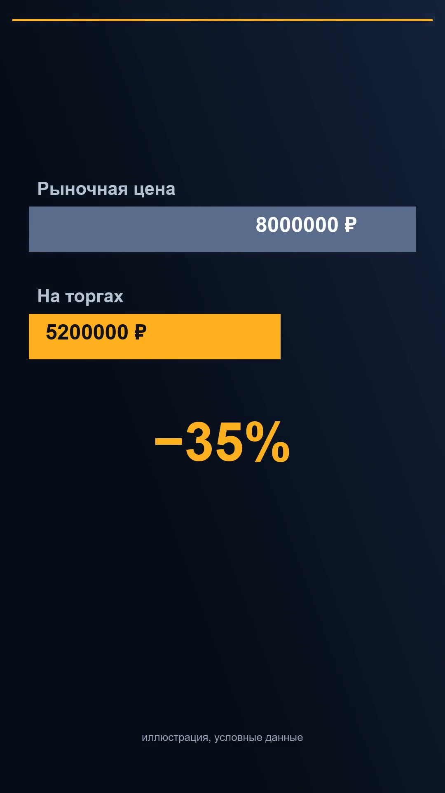
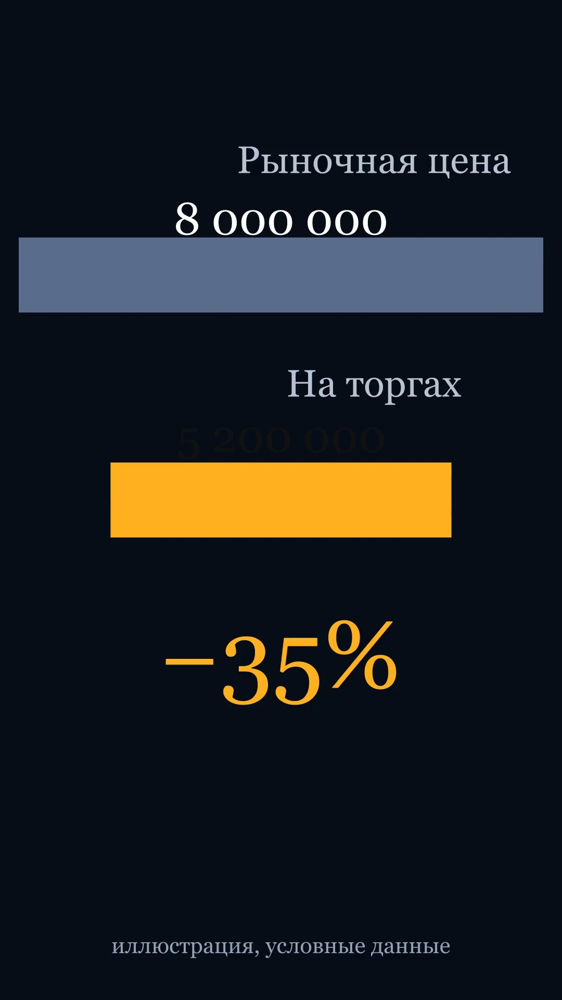
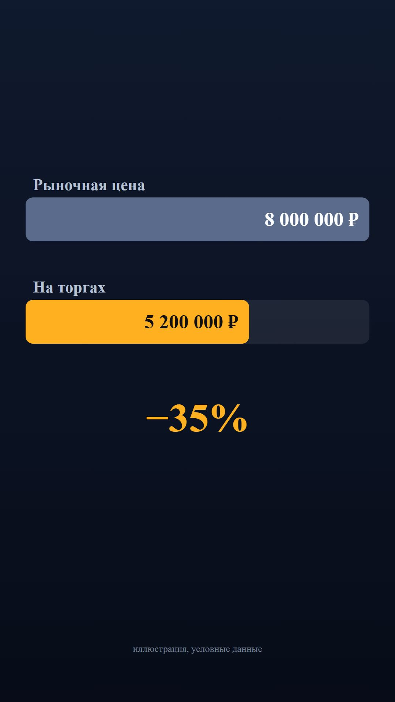
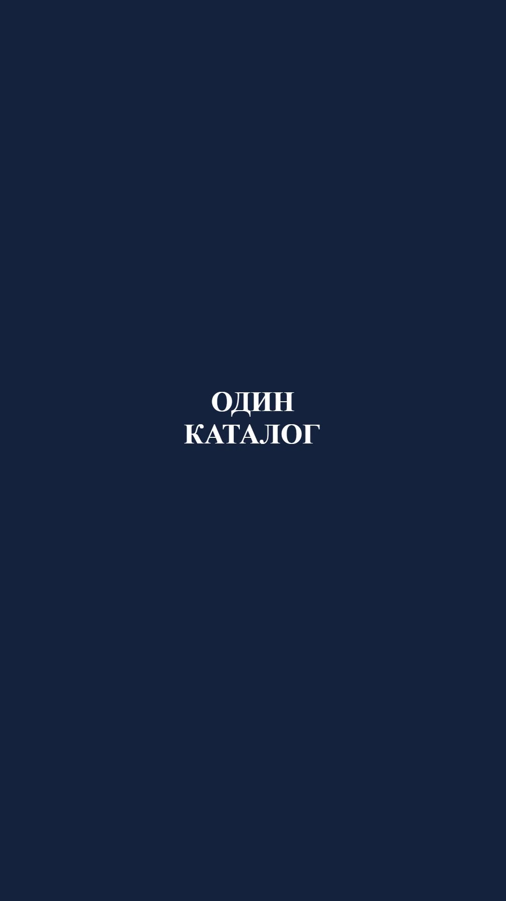

<div align="center">

# 🎬 AI Video Studio

**Автономная студия вертикального видео для AI-агентов**
Идея → сценарий → озвучка → анимация → QC → готовый MP4 — одной командой `/video`

**Приоритетные CLI: ZCode · OpenCode** (совместимо с любым агентом, читающим Markdown-инструкции)

[](LICENSE)
[](docs/AGENT-SETUP.md)
[](docs/AGENT-SETUP.md)
[](#формат)
[](#стоимость)

</div>

---

## Что это

Полный производственный конвейер коротких вертикальных роликов (Reels/Shorts/TikTok), собранный из шести **субагентов-ролей**, **двухуровневого рендера без браузера** и **каталога из 142 проверенных анимаций-референсов** с живой веб-галереей.

```
                    ┌──────────────────────────────┐
   «/video тема» ──▶│   🎬 VIDEO DIRECTOR (сессия) │  координирует, не рендерит
                    └──────┬───────────────────────┘
        ┌──────────┬───────┴──────┬───────────┬─────────────┐
        ▼          ▼              ▼           ▼             ▼
  ┌──────────┐ ┌─────────┐  ┌──────────┐ ┌─────────┐ ┌──────────────┐
  │SCRIPT-   │ │VOICE-   │  │MOTION-   │ │VIDEO-   │ │QUALITY CTRL  │
  │WRITER    │ │PRODUCER │  │DESIGNER  │ │EDITOR   │ │(ffprobe/AV1  │
  │сценарий  │ │edge-tts │  │драфт+маним│ │ffmpeg/  │ │whisper/кадры)│
  │+таймкоды │ │−14 LUFS │  │remotion  │ │субтитры │ │→ PASS/FAIL   │
  └──────────┘ └─────────┘  └──────────┘ └─────────┘ └──────┬───────┘
                                                            │ FAIL → возврат роли
                                                            ▼ (макс. 3 цикла)
                                                   📦 output/<slug>.mp4
```

**Ключевые решения, ради которых проект существует:**
- 🚫 **Никакого Chrome на этапе итераций** — собственный компилятор «спецификация → ffmpeg filtergraph» рендерит драфты в **7–11 раз быстрее Remotion** (замеры: 4.1 с против 27.9 с на сцене 120 кадров).
- 🎨 **142 референса с живыми демо** — каталог анимаций (MIT/CC0-источники: Opus Motion Library, RenderComp, reactvideoeditor, Digital Samba) + HTML-галерея с поиском, фильтрами и мультивыбором по ID.
- 🔊 **Русская озвучка без API-ключей** — edge-tts с автобилками (сервис нестабилен) + локальная нормализация −14 LUFS.
- ✅ **QC как роль, а не надежда** — отдельный агент прогоняет ffprobe/blackdetect/silencedetect/ebur128/whisper-сверку/визуальный осмотр кадров и возвращает FAIL-пункты авторам ролей.
- 🤖 **Формат для агентов** — агенты, команда и скиллы это Markdown-файлы с frontmatter; установка — исполняемый runbook `docs/AGENT-SETUP.md`.

## Быстрый старт

**1. Попросите вашего агента:**
> «Установи ai-video-studio по `docs/AGENT-SETUP.md`»

Агент скопирует компоненты в ZCode/OpenCode, подставит пути, проверит зависимости и отчитается. Ручной путь — там же, шаги 1–3.

**2. Перезапустите CLI и скажите:**
```
/video Сделай ролик на тему «Как купить недвижимость с торгов банкротов», 45 секунд
```

**3. Получите** `output/<slug>.mp4` + QC-отчёт + список использованных референсов.

<details>
<summary><b>Ручной путь без /video</b></summary>

```
Сделай ролик на тему «…» 30 секунд
```
Тот же конвейер, но: агент выполняет роли **сам**, по одному этапу на вызов субагента — **никогда** не отдавайте весь конвейер одному субагенту (субагенты не могут порождать субагентов).

</details>

## Трёхъярусный рендер

| Ярус | Движок | Время (сцена 120 кадров) | Когда |
|---|---|---|---|
| 🥇 **Драфт** | `tools/draft-render.mjs` → **ffmpeg filtergraph** | **4.1 с** (x264) / **2.7 с** (AMF GPU) | итерации контента/тайминга, QC-циклы |
| 🥈 **Натив** | **Manim CE** (Cairo, без браузера) | ~55 с @30fps | графики, формулы, плавная математика |
| 🥉 **Финал** | **Remotion** (React, headless Chrome) | 27.9 с+ | публикационный ролик |

<p align="center">
  
  
  
  
</p>
<p align="center"><i>Одна и та же сцена «сравнение цен» в трёх движках + тест библиотеки. Данные условные.</i></p>

## Каталог референсов (142 позиции)

Живая галерея: `python -m http.server 4173 --bind 127.0.0.1` из `reference-library/` → **http://127.0.0.1:4173/gallery/index.html**

- поиск по ключевым словам, фильтры «Бесплатно / Есть код / Инфографика / Современные»
- клик по ID копирует его; мультивыбор → `selection.json` → Motion Designer'у
- каждая карточка — **живая HTML-анимация** (движок демо без зависимостей), не скриншот
- лицензии разобраны в [reference-library/LICENSES.md](reference-library/LICENSES.md): 126 позиций с кодом MIT, 130 коммерчески-OK; reference-only источники (без лицензии) помечены и не копируются в коммерческие видео

## Состав репозитория

```
agents/                  6 субагентов: director, scriptwriter, voice-producer,
                         motion-designer, video-editor, quality-controller
commands/video.md        slash-команда запуска конвейера
skills/                  video-style-reference · modern-motion-reference
tools/                   draft-render.mjs (ffmpeg-компилятор), transcribe.py,
                         manim-пример, шрифтовые заглушки (fonts/ ставится локально)
reference-library/       catalog.json (142) + галерея + движок демо + поиск + лицензии
config/studio.json       форматы, громкость, голоса, движки
docs/                    AGENT-SETUP.md (runbook) · benchmarks.md · ffmpeg9-pitfalls.md ·
                         mcp-template.json
examples/                спеки и кадры-превью
```

## Формат

**1080×1920 (9:16) · 30 FPS · MP4 H.264 CRF 19 · AAC 192k 48kHz · −14 LUFS · русская озвучка + burn-in субтитры · 30–60 с.** Поддержаны 16:9 и 1:1. Аппаратное ускорение: AMD AMF / NVIDIA NVENC / Intel QSV (детектится ffmpeg).

## Стоимость

| Бесплатно локально | Требует ключ (опционально) |
|---|---|
| FFmpeg, ffmpeg-драфт, Manim, edge-tts (ru), faster-whisper, галерея, каталог, QC | ElevenLabs MCP (подготовлен, `enable:false`) · Remotion лицензия для компаний >3 человек (частные лица — бесплатно) |

## Документация

- [docs/AGENT-SETUP.md](docs/AGENT-SETUP.md) — исполняемый runbook установки для агента
- [docs/benchmarks.md](docs/benchmarks.md) — методика и полные замеры рендеров
- [docs/ffmpeg9-pitfalls.md](docs/ffmpeg9-pitfalls.md) — грабли нового парсера filtergraph (кавычки/двоеточия/textfile) — сэкономит часы
- [reference-library/LICENSES.md](reference-library/LICENSES.md) — лицензии всех 142 позиций

## Известные ограничения

- edge-tts (Microsoft) нестабилен → ретраи зашиты в voice-producer; для полного оффлайна планируем локальный TTS.
- Субагенты не порождают субагентов — конвейер оркестрирует главная сессия (правило вписано во все тексты).
- Chatterbox/локальный GPU-TTS — осознанно не включены (CPU-инференс непрактичен без CUDA).

## Кредиты

Собрано на плечах: [FFmpeg](https://ffmpeg.org) · [Remotion](https://remotion.dev) · [Manim CE](https://manim.community) · [Opus Motion Library](https://github.com/GovinduSasanka/opus-motion-library) · [RenderComp templates](https://github.com/RenderComp/free-remotion-templates) · [reactvideoeditor templates](https://github.com/reactvideoeditor/remotion-templates) · [digitalsamba toolkit](https://github.com/digitalsamba/claude-code-video-toolkit) · [iart-ai skills](https://github.com/iart-ai/motion-skills) · [awesome-claude-video-skills](https://github.com/zhuyansen/awesome-claude-video-skills) (навигатор). Атрибуция и лицензии — [LICENSES.md](reference-library/LICENSES.md).

---

<div align="center">

**MIT** · собрано агентами, для агентов · PR приветствуются

</div>
